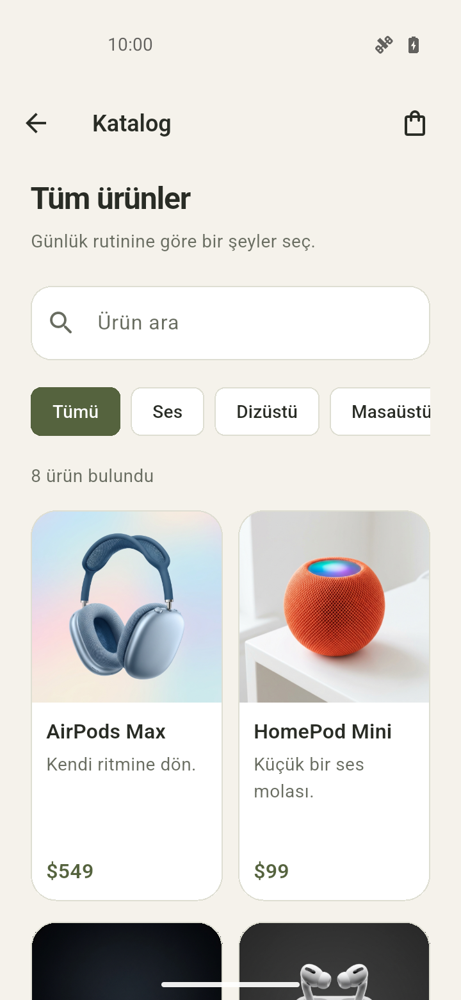
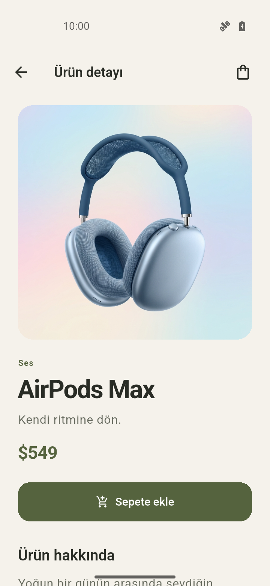
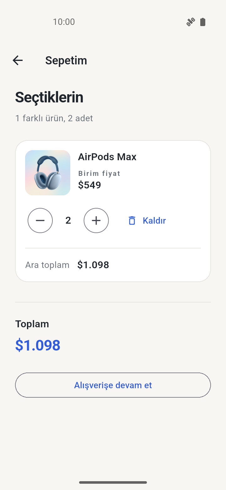

# Mini Katalog

Ürün listeleme, arama, kategori filtresi, ürün detayı ve basit sepet işlemleri içeren Flutter uygulaması. 8 örnek ürün yerel JSON dosyasından okunur. Sepette adet değiştirilebilir ve ürün kaldırılabilir. Uygulama kapatılınca sepet sıfırlanır.

Flutter sürümü: **3.47.7 (stable)**. Ek uygulama paketi kullanılmadı.

## Çalıştırma

Flutter ve Android SDK kurulu olmalı. Android emülatörünü başlat veya USB hata ayıklaması açık bir cihaz bağla.

```bash
git clone https://github.com/berkaykyb/tnc_minikatalog.git
cd tnc_minikatalog
flutter pub get
flutter run
```

Android emülatöründe test edildi.

## Ekran görüntüleri

| Ana sayfa | Katalog | Ürün detayı | Sepet | Boş sepet |
| --- | --- | --- | --- | --- |
|  |  |  |  |  |

## Kaynak

Ürün görselleri ödevde verilen [WANTAPI](https://wantapi.com/products.php) kaynağından alındı. Proje eğitim amaçlıdır.
